<div align="center">


# Communitie Racing Quiz League

**Predict the race. Own the grid.**

A prediction game for every Formula 1 Grand Prix. Before lights out, players answer a few questions
about the race; after the chequered flag, answers are scored and the season championship updates.

Works on **iPhone (Safari)**, **Android (Chrome)** and **desktop**, and installs to the home screen as an app.


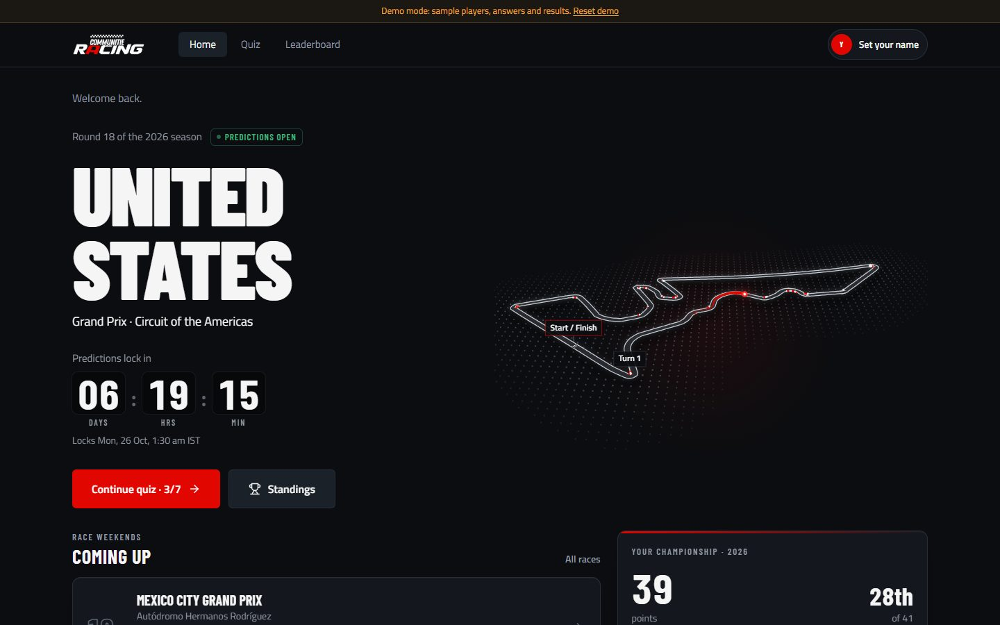

</div>

---

## Contents

- [What players do](#what-players-do)
- [Screenshots](#screenshots): [Android](#android) · [iPhone](#iphone-ios) · [Desktop](#desktop)
- [Runs everywhere](#runs-everywhere)
- [Project structure](#project-structure)
- [Quick start (demo, no backend)](#quick-start-demo-no-backend)
- [Run the full stack locally](#run-the-full-stack-locally)
- [Tests and builds](#tests-and-builds)
- [Admin guide](#admin-guide)
- [Deploying to Render](#deploying-to-render)
- [Credits](#credits)

## What players do

1. **Sign in with their email.** No password: a 6-digit code arrives by email. New players choose the
   racing name everyone sees on the leaderboard.
2. **Answer the race quiz.** Pick the winner, put the podium in order, guess a number, yes or no. Every
   tap saves straight away. There is no submit button.
3. **Get a Prediction Pass.** A ticket that lists every pick. Tap any line to change it until lights out.
4. **Answers lock at lights out.** The server refuses late answers, whatever the device clock says.
5. **Climb the standings.** After the race an admin enters the results, the server scores every pass, and
   the championship table updates with position changes, ties and a podium.

Highlights:

- A rotating globe that pins the next Grand Prix, and a 3D circuit map on the Home screen
- A five-light start sequence (with optional beeps) when you sign in
- A timing-tower leaderboard with search, "Find me" and your own row pinned in view
- Every date and time shown in Indian Standard Time
- Respects "Reduce motion" on every platform

## Screenshots

All screenshots were taken from the built-in demo mode, so the names and scores are sample data.

### Android

<table>
  <tr>
    <td align="center">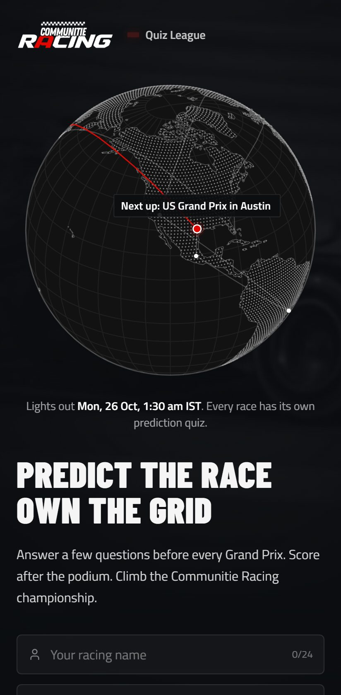<br /><sub>Sign in</sub></td>
    <td align="center">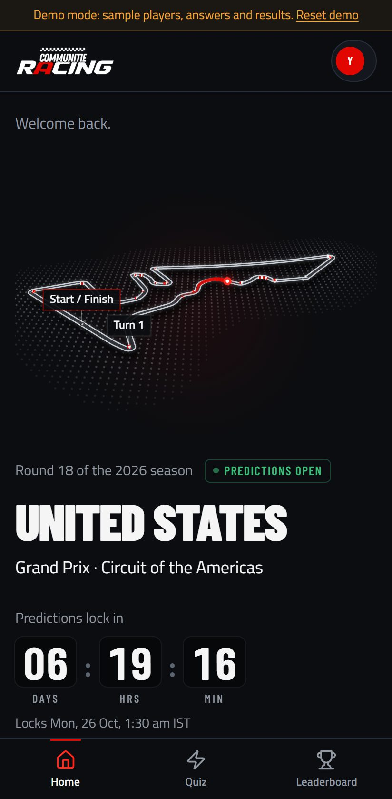<br /><sub>Home</sub></td>
    <td align="center">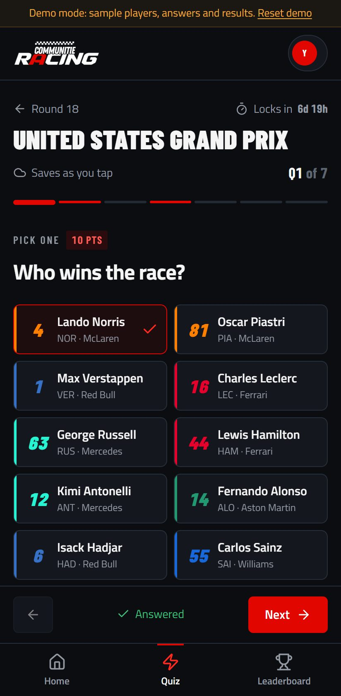<br /><sub>Quiz</sub></td>
    <td align="center">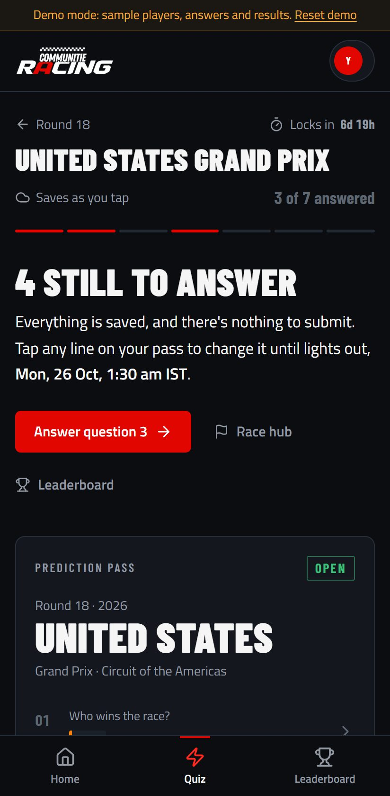<br /><sub>Prediction Pass</sub></td>
    <td align="center">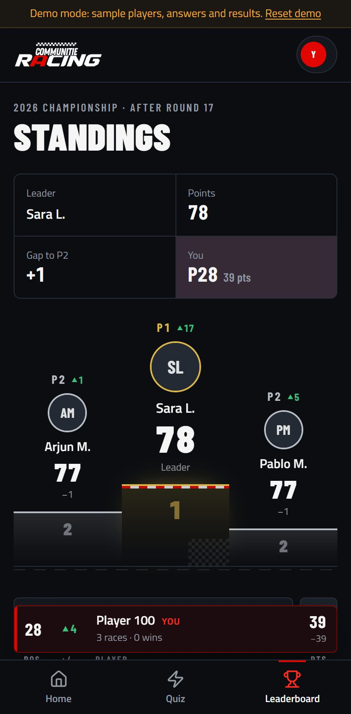<br /><sub>Standings</sub></td>
  </tr>
</table>

<sub>Chrome on Android, Pixel 7 size.</sub>

### iPhone (iOS)

<table>
  <tr>
    <td align="center">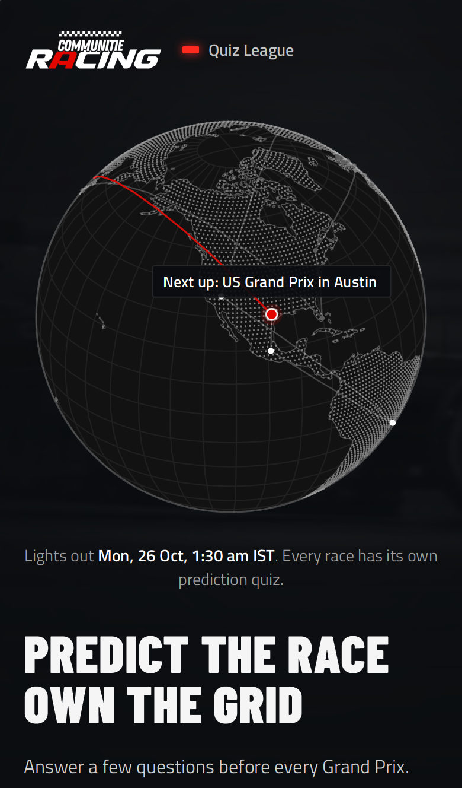<br /><sub>Sign in</sub></td>
    <td align="center">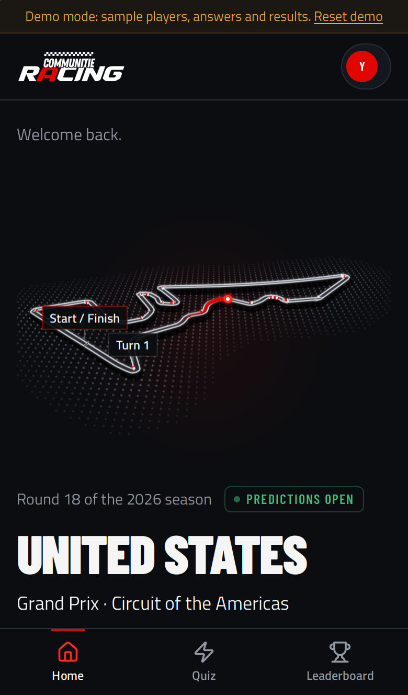<br /><sub>Home</sub></td>
    <td align="center">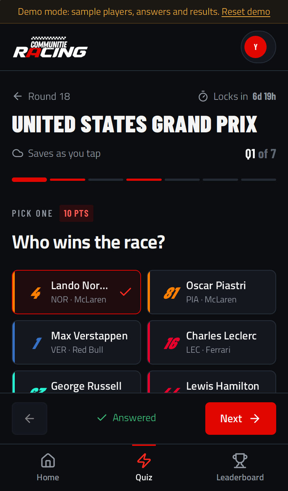<br /><sub>Quiz</sub></td>
    <td align="center">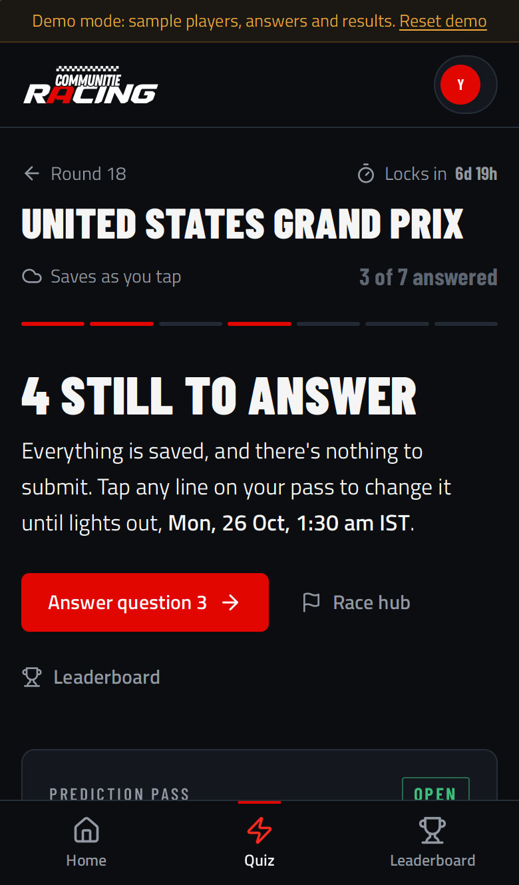<br /><sub>Prediction Pass</sub></td>
    <td align="center">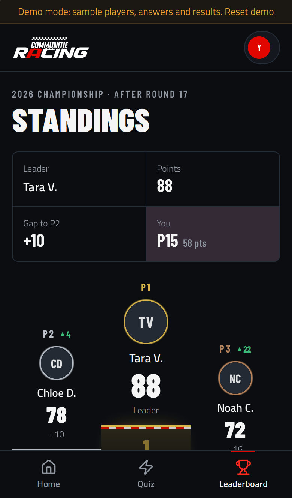<br /><sub>Standings</sub></td>
  </tr>
</table>

<sub>Safari on iPhone (WebKit), iPhone 13 size.</sub>

### Desktop

| Sign in | Quiz |
|---|---|
| 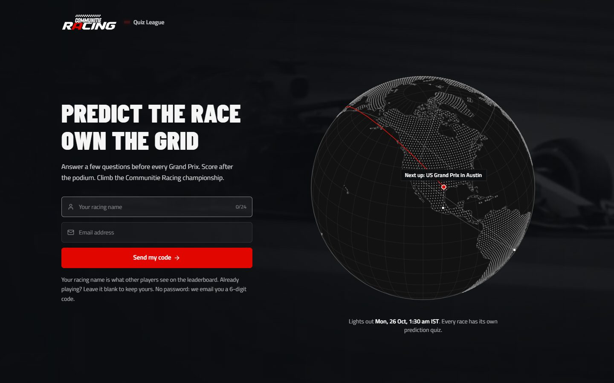 | 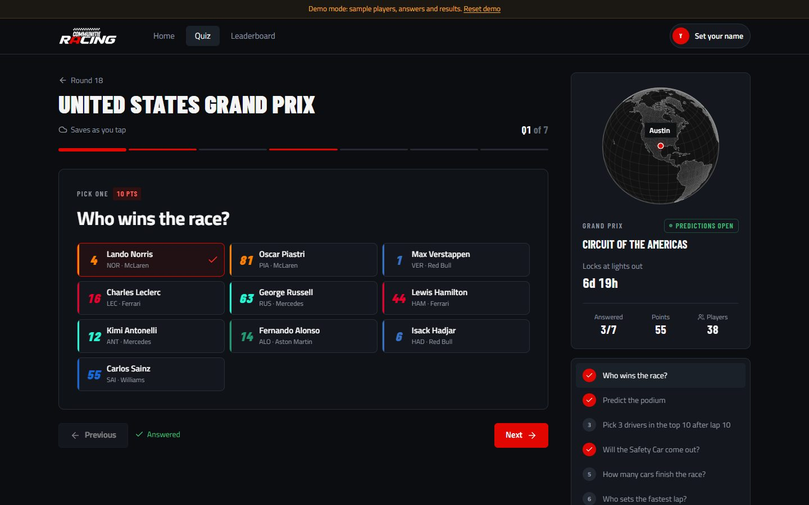 |
| **Prediction Pass** | **Standings** |
| 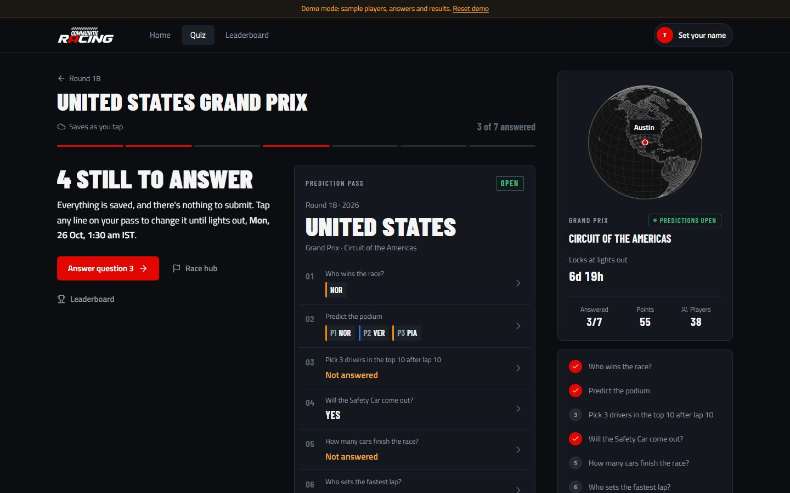 | 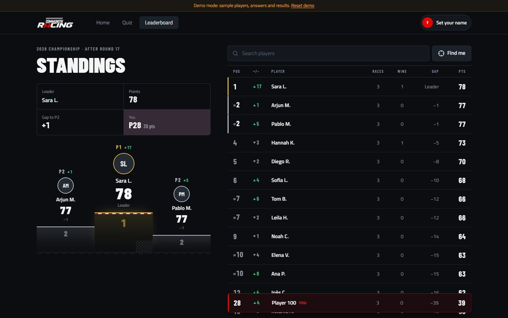 |

<sub>1440 × 900 browser window.</sub>

## Runs everywhere

| Platform | Browser | Notes |
|---|---|---|
| **iPhone / iPad** | Safari | Safe-area aware (notch and home bar). The background video plays muted inline and falls back to a still image. **Install:** Share → *Add to Home Screen*. |
| **Android** | Chrome | Bottom tab bar sized for thumbs (44 px+ targets). **Install:** ⋮ menu → *Install app* / *Add to Home screen*. |
| **Desktop** | Chrome, Edge, Safari, Firefox | Top navigation, wider layouts with side panels. Chrome and Edge can install it from the address bar. |
| **Installed app (PWA)** | All of the above | Opens full screen as "CR Quiz" with its own icon. Needs a connection (there's no offline mode). |

Every screen is checked at 320 px wide and up, in portrait and landscape, with no sideways scrolling.

## Project structure

```text
.
├── frontend/                 React 18 + Vite + TypeScript + Tailwind (the web app)
│   ├── public/               Icons, logo, PWA manifest, world map data
│   └── src/
│       ├── api/              API client, endpoints and types
│       ├── components/       UI: quiz inputs, Prediction Pass, leaderboard, globe, 3D circuit, layout
│       ├── demo/             In-browser demo backend (same rules as the server)
│       ├── fixtures/         2026 calendar, circuits, track outlines, drivers
│       ├── hooks/            Auth, autosave, countdown, data queries
│       ├── utils/            Date/time formatting (IST), answer helpers
│       ├── pages/            Login, Home, Races, Quiz, Leaderboard, Profile, Admin
│       └── styles/
├── backend/                  FastAPI + SQLAlchemy (async) + PostgreSQL
│   ├── app/
│   │   ├── api/              Routes: auth, races, admin
│   │   ├── core/             Settings, database, security
│   │   ├── services/         Email codes, scoring, results, scheduler
│   │   └── admin_panel.py    Data editor at /admin (SQLAdmin)
│   ├── alembic/              Database migrations
│   └── tests/                58 API and scoring tests
├── docs/
│   ├── screenshots/          The images in this README
│   ├── design-brief.md       The UI brief, with notes on what was built
│   └── backend-gaps.md       Features the UI wants that the API doesn't serve yet
├── .github/workflows/ci.yml  Tests and builds on every push
└── render.yaml               Render Blueprint (ready, not deployed yet)
```

## Quick start (demo, no backend)

Needs **Node 20+** (22 recommended, see `frontend/.nvmrc`).

```bash
cd frontend
npm install
echo "VITE_DEMO=true" > .env.local
npm run dev            # http://localhost:5173
```

Demo mode runs every screen on clearly labelled sample data in the browser. Any 6-digit code signs you
in (`000000` shows the wrong-code error), and **Reset demo** in the banner starts over. Open
`http://localhost:5173/?demo-login` to skip sign-in.

**Try it on your phone:** connect it to the same Wi-Fi and open `http://<your computer's IP>:5173`.

## Run the full stack locally

### Backend

Needs **Python 3.13** and **PostgreSQL 17**.

```bash
cd backend
python -m venv .venv
# Windows: .venv\Scripts\activate     macOS/Linux: source .venv/bin/activate
pip install -r requirements-dev.txt
cp .env.example .env                  # then set DATABASE_URL, JWT_SECRET, ADMIN_EMAILS
alembic upgrade head                  # create/update tables
uvicorn app.main:app --reload         # http://localhost:8000
```

- API docs: http://localhost:8000/docs
- While `RESEND_API_KEY` is empty, login codes print in the server log instead of being emailed.
- Emails listed in `ADMIN_EMAILS` become admins when they sign in.
- "Continue with Google" needs `GOOGLE_CLIENT_ID` here and `VITE_GOOGLE_CLIENT_ID` in the frontend. The page's origin
  (e.g. `http://localhost:5173`) must be listed under the client's Authorized JavaScript origins in Google Cloud.

### Frontend against the real backend

```bash
# frontend/.env.local
VITE_DEMO=false
VITE_API_URL=http://localhost:8000
```

Then restart `npm run dev`.

### Environment variables

| Where | Variable | What it does |
|---|---|---|
| backend | `DATABASE_URL` | Postgres URL (`postgres://` and `postgresql://` both work) |
| backend | `JWT_SECRET` | Long random string that signs sessions |
| backend | `ADMIN_EMAILS` | Comma-separated emails that become admins |
| backend | `RESEND_API_KEY`, `EMAIL_FROM` | Sends login codes via Resend; empty = print to log |
| backend | `EMAIL_LOGO_URL` | Public URL of the logo in the login email; empty = name in text |
| backend | `GOOGLE_CLIENT_ID` | OAuth web client ID for "Continue with Google"; empty = switched off |
| backend | `FRONTEND_ORIGIN` | Web app URL(s) allowed to call the API, comma-separated |
| backend | `SENTRY_DSN` | Optional error reporting |
| backend | `OPENF1_USERNAME`, `OPENF1_PASSWORD` | Paid OpenF1 account: results fill in **live** during the race. Empty = after the race |
| backend | `OPENF1_LIVE_INTERVAL_SECONDS` | How often to read OpenF1 during a race (default 20) |
| frontend | `VITE_API_URL` | API base URL, baked in at build time |
| frontend | `VITE_DEMO` | `true` = run on in-browser sample data |
| frontend | `VITE_GOOGLE_CLIENT_ID` | Same client ID as the backend; empty = no Google button |

Templates: [`backend/.env.example`](backend/.env.example), [`frontend/.env.example`](frontend/.env.example).
Never commit `.env` or `.env.local`; both are git-ignored.

## Tests and builds

```bash
# frontend
cd frontend
npm test               # unit tests (Vitest)
npm run build          # type check + production build into frontend/dist

# backend (uses a separate <db name>_test database, created and wiped automatically)
cd backend
python -m pytest -q
```

GitHub Actions runs both on every push and pull request
([`.github/workflows/ci.yml`](.github/workflows/ci.yml)); the backend job uses a Postgres 17 service container.

Changing the schema: edit `backend/app/models.py`, then

```bash
alembic revision --autogenerate -m "what changed"
alembic upgrade head
```

## Admin guide

Open `<API URL>/admin`, enter your email, press **Send code** and type the code. Only `ADMIN_EMAILS` get in.

- **Races:** create a race. Times are typed and shown in IST (stored as UTC).
- **Questions:** add questions to a draft race, or select it and use **Copy questions from previous race**.
- **Open quiz to players:** select the race, then Actions. Players can answer between the opening and closing times.
- Answers lock at the closing time automatically. **Close quiz now** locks them early.
- Once a quiz is open, you can fix a question's wording or points, but not its type, options or config.

Question types and their `options` / `config`:

| Type | Example | options | config |
|---|---|---|---|
| Pick one | Who wins? | `["VER","NOR","LEC"]` | `{}` |
| Pick several | 3 drivers in the top 10 after lap 10 | full grid | `{"pick": 3}` |
| Put in order | Predict the podium | full grid | `{"pick": 3}` |
| Number | How many cars pit under the safety car? | `[]` | `{"min": 0, "max": 20, "tolerance": 1}` |
| Yes / no | Will both Ferraris finish on the podium? | `[]` | `{}` |

Add `"scoring": "all"` to Pick several / Put in order for all-or-nothing points; otherwise each correct pick earns its share.

### Race weekend flow (API)

| Step | Who | Endpoint |
|---|---|---|
| See races and answer (autosaves) | player | `GET /races`, `GET /races/{id}`, `PUT /races/{id}/answers` |
| Enter results, during or after the race | admin | `PUT /admin/races/{id}/answer-key` |
| Save & score after the flag | admin | `PUT /admin/races/{id}/answer-key` with `"score": true` |
| Publish results held for review | admin | `POST /admin/races/{id}/publish` |
| A penalty changed the result | admin | `POST /admin/races/{id}/rescore` |
| Race results and season standings | player | `GET /races/{id}/leaderboard`, `GET /standings` |
| Fill results from OpenF1 now (or preview with `"save": false`) | admin | `POST /admin/races/{id}/openf1/sync` |
| Which OpenF1 session a race uses | admin | `POST /admin/races/{id}/openf1/link`, `GET /admin/races/{id}/openf1` |
| Any OpenF1 API, filters passed through | admin | `GET /admin/openf1/data/{endpoint}?…` |

### Automatic results from OpenF1

Questions can be answered automatically from [OpenF1](https://openf1.org). Give a question an
**Auto-answer** rule (in `/admin` → Questions, or `"auto"` in the API) and the backend fills its result:

| Phase | Without an account (free) | With a paid OpenF1 account |
|---|---|---|
| During the race | Nothing (OpenF1 locks live sessions) | Every ~20 s, saved as **live / provisional** |
| After the flag | Within minutes of the official classification | Same |
| Next 6 hours | Re-checked every 10 min for penalties | Same |

- Live values are the race so far (current leader, safety cars so far…). A race **can't be scored** while any result is
  still provisional; the official classification replaces them automatically.
- A result you type in yourself is **never overwritten** by OpenF1.
- You still press **Score**. The race's OpenF1 session is found automatically from the season and quiz deadline.
- Rules: `GET /admin/openf1/rules`. Common ones:

| Question | type | auto |
|---|---|---|
| Who wins? | Pick one | `{"rule": "winner"}` |
| Who takes pole? | Pick one | `{"rule": "pole"}` |
| Predict the podium | Put in order (pick 3) | `{"rule": "top", "n": 3}` |
| 3 drivers in the top 10 after lap 10 | Pick several | `{"rule": "top_after_lap", "lap": 10, "n": 10}` |
| Fastest lap? | Pick one | `{"rule": "fastest_lap"}` |
| Will there be a safety car? | Yes / no | `{"rule": "safety_car"}` (add `"include_vsc": true` to count a VSC) |
| How many cars pit under the safety car? | Number | `{"rule": "pit_stops_under_sc"}` |
| How many retirements? | Number | `{"rule": "retirements"}` |
| Will both Ferraris finish on the podium? | Yes / no | `{"rule": "team_both_in_top", "team": "Ferrari", "n": 3}` |
| Red flag? / Rain? | Yes / no | `{"rule": "red_flag"}` / `{"rule": "rain"}` |

Not available from OpenF1 (enter by hand): Driver of the Day, and anything about stewards' decisions.

## Deploying to Render

Live address: **https://communitieracing.in** (API: **https://api.communitieracing.in**).
[`render.yaml`](render.yaml) sets up everything in one go:

| Service | Type | Build | Start | Address |
|---|---|---|---|---|
| `crql-db` | PostgreSQL | | | private |
| `crql-api` | Python web service (`backend/`) | `pip install -r requirements.txt` | `alembic upgrade head && uvicorn …` | api.communitieracing.in |
| `crql` | Static site (`frontend/`) | `npm ci && npm run build` | serves `dist/` (single-page app) | communitieracing.in, www → redirects |

1. Render dashboard → **New → Blueprint** → choose this repository. Fill in what it asks for:
   `ADMIN_EMAILS` (comma-separated), `RESEND_API_KEY`, `GOOGLE_CLIENT_ID` and `VITE_GOOGLE_CLIENT_ID`
   (the same OAuth client ID). Leave `SENTRY_DSN` empty if unused. `JWT_SECRET` is generated.
2. **DNS at Hostinger** (Domains → DNS / Nameservers). Render shows the exact values under each service →
   Settings → Custom Domains; they are normally:

   | Type | Name | Points to |
   |---|---|---|
   | A | `@` | `216.24.57.1` (replace the existing `@` A record) |
   | CNAME | `www` | `crql.onrender.com` |
   | CNAME | `api` | `crql-api.onrender.com` |

   Remove any `AAAA` record on `@`. Keep the Resend records for `mail.communitieracing.in`. Then press **Verify**
   on each domain in Render; HTTPS certificates are issued automatically.
3. **Google Cloud Console** → OAuth client → Authorised JavaScript origins: add `https://communitieracing.in`
   and `https://www.communitieracing.in`.
4. **Resend** → Domains: `mail.communitieracing.in` must be *Verified*, or codes only reach the Resend account owner.
5. **Load the season** from your computer, using `crql-db`'s *External Database URL*:

   ```bash
   cd backend
   DATABASE_URL="<external database URL>" .venv/Scripts/python.exe -m app.seed
   ```

Every push to `main` redeploys. If Render named a service differently (e.g. `crql-api-x1y2`), point the CNAMEs at
those names instead.

On the free plan the API sleeps after 15 idle minutes (the first request then takes about a minute), and free Postgres
is deleted after 30 days: upgrade the database before real players join. Answers still lock on time while the API
sleeps, because the deadline is checked on every save.

## Credits

- Unofficial fan community project by Communitie Racing, Hyderabad. Not affiliated with Formula 1, the FIA or any team.
- Circuit outlines: [bacinger/f1-circuits](https://github.com/bacinger/f1-circuits) (MIT).
- World map: Natural Earth 1:110m land (public domain), self-hosted.
- Login background: Red Bull Racing's GIPHY clip, embedded from GIPHY.
- Fonts: Titillium Web and Barlow Condensed (Google Fonts, OFL).
